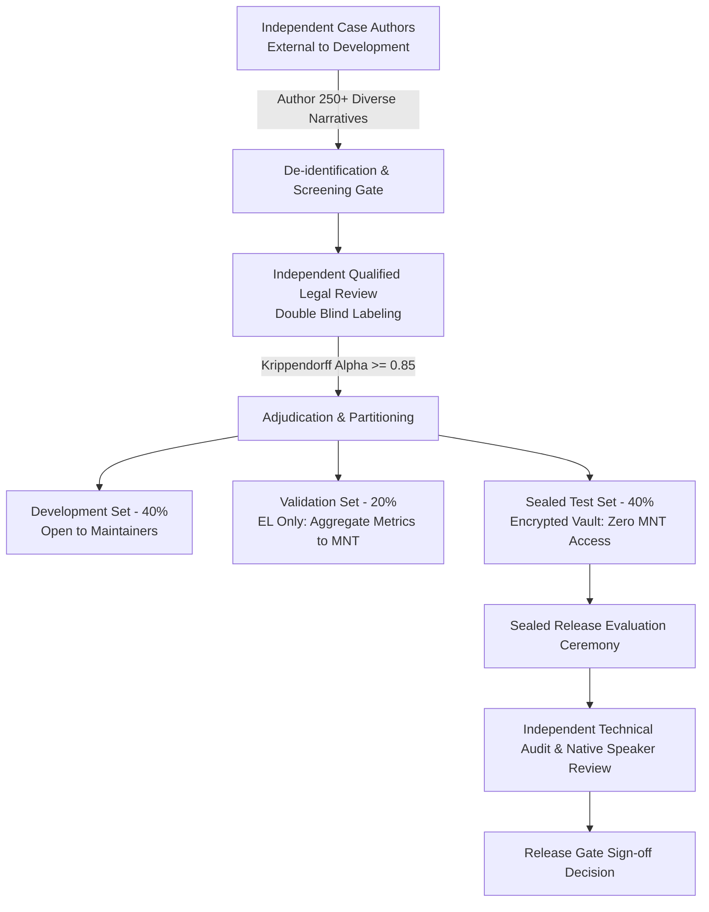

# Bandhoo Independent Evaluation Protocol: Release Readiness & Verification Standards

**Document Identifier:** PROTOCOL-EVAL-2026-V1  
**Status:** Ready for Review / Authorised Sign-off  
**Checkpoint:** Checkpoint 3 — Independent Evaluation Readiness  
**Target Audience:** Project Owners (PO), Evaluation Lead (EL), Qualified Legal Reviewers (QLR), Native Language Reviewers (NLR), Independent Technical Auditor (ITA), and Maintainers (MNT).

---

## 1. Non-Negotiable Foundational Principle

> [!IMPORTANT]
> **Internally written synthetic cases (`benchmark/bns_synthetic_benchmark_50.json` and `benchmark/structuring/structuring_cases.json`) are engineering development artifacts.**
> They were written during system implementation, inspected iteratively, and reflect the developers' understanding at development time. **They must never be claimed, reported, or described as independent external validation.**
>
> Release Blocker **RB-45** remains **OPEN** until an external, legally reviewed, sealed evaluation dataset authored by independent parties is evaluated and accepted.

---

## 2. Protocol Overview & Governance Architecture



### 2.1 Separation of Roles & Conflict-of-Interest Controls
To eliminate developer bias and ensure verifiable independence, the following roles are strictly segregated:

| Role | Permitted Personnel | Prohibited Personnel | Custody & Access Rights |
| :--- | :--- | :--- | :--- |
| **Evaluation Lead (EL)** | Senior evaluation specialist external to the Bandhoo engineering team. | Anyone who wrote code, prompts, regexes, or corpus loaders for Bandhoo. | Full access to raw evaluation cases, splits, gold labels, and scoring pipelines. |
| **Case Authors (CA)** | Legal clinic researchers, court reporters, civic paralegals. | Bandhoo developers, maintainers, prompt engineers. | Access only to narrative generation guidelines; **zero** access to Bandhoo codebase or outputs. |
| **Qualified Legal Reviewers (QLR 1 & 2)** | Qualified advocates in Indian criminal law (minimum 5 years criminal bar practice). | Anyone involved in Bandhoo development or initial corpus scraping. | Double-blind access to narratives; no access to model predictions or counterpart reviewer labels. |
| **Legal Adjudicator (ADJ)** | Senior criminal law practitioner / retired judicial officer. | Bandhoo developers, QLR 1, QLR 2. | Access to disputed labels only; final authority on statutory gold labels. |
| **Native Language Reviewers (NLR)** | Native Marathi (Konkan/Mumbai) and Hindi/Hinglish linguists/speakers. | Bandhoo developers. | Access to UI prompts, draft complaint texts, and multilingual narratives. |
| **Independent Technical Auditor (ITA)** | External software engineer / ML validation auditor. | Bandhoo developers. | Full access to codebase, test harness scripts, and metric verification mathematical routines. |
| **Bandhoo Maintainers (MNT)** | System engineering team. | Must not perform evaluation lead or reviewer roles. | **Restricted strictly to Development Set**. No access to Validation or Test narratives/labels. |

---

## 3. Protocol 1: Authoring the Independent Evaluation Dataset

### 3.1 Dataset Scale and Composition Targets
The independent dataset must comprise at least **250 cases** distributed across the operational matrix:

| Axis | Dimension | Minimum Cases | Coverage Requirement |
| :--- | :--- | :--- | :--- |
| **Language** | English | 100 | Formal prose, colloquial syntax, typos, emotional digressions |
| | Hinglish (Latin script) | 75 | Mumbai Bambaiya idiom, phonetic transliteration, code-switching |
| | Marathi (Devanagari script) | 75 | Administrative Marathi and colloquial Mumbai/Konkan vernacular |
| **Legal Family** | Direct Theft & Conversion | 35 | BNS 303(1), 303(2), 314; varying property valuations |
| | Snatching & Robbery | 40 | BNS 304, 309, 310, 311; weapons vs bodily restraint |
| | Trespass & House-breaking | 30 | BNS 329, 331, 305; dwellings, commercial shops, garages |
| | Criminal Breach of Trust & Fraud | 30 | BNS 316(1)-(5), 318; employment capacity vs commercial breach |
| | Hurt & Violent Offences | 30 | BNS 115, 117, 118, 126, 134; weapons, simple vs grievous hurt |
| | Intimidation & Sexual Offences | 25 | BNS 351, 64, 74; verbal threats, extortionate demands |
| | Non-Penal Grievances | 30 | Consumer pricing, tenancy civil disputes, metaphorical complaints |
| | Vague / Fragmented Narratives | 30 | Extreme brevity (<10 words), contradictory statements, incoherent |

### 3.2 Sourcing Methodology
1. **Real-World Anonymized Fact Patterns (40%)**: Derived from public domain complaints or police records de-identified in strict adherence to Section 6.
2. **First-Person Judicial Adaptations (40%)**: Fact patterns extracted from reported Bombay High Court and Supreme Court criminal appeals, rewritten into first-person complainant voices with real-world noise (omissions, confusion, emotional state).
3. **Independent Parallel Scenarios (20%)**: Authored by external paralegals guided by statutory element checklists without inspecting system code.

---

## 4. Protocol 2: Blind Held-Out Cases & Cryptographic Custody

### 4.1 Partition Architecture (40 / 20 / 40)
The 250+ cases are partitioned into three immutable splits:
1. **Development Split (40%)**: Publicly available in the repository for ongoing model fine-tuning, deterministic regex adjustments, and prompt iteration.
2. **Validation Split (20%)**: Held by the Evaluation Lead. Used solely for model checkpoint selection and hyperparameter tuning. Maintainers receive **aggregate metrics only**; individual case IDs, error snippets, or confusion matrices for specific cases are withheld.
3. **Blind Held-Out Test Split (40%)**: Sealed in an external, access-controlled repository (`bandhoo-eval-vault`). Maintainers have zero access.

### 4.2 Cryptographic Sealing & Anti-Leakage Controls
```bash
# Sealing ceremony command run by Evaluation Lead
sha256sum bandhoo_independent_test_v1.json > bandhoo_independent_test_v1.sha256
gpg --armor --detach-sign bandhoo_independent_test_v1.sha256
```
- **Hash Publication**: The SHA-256 hash of the sealed dataset is committed to `reports/independent_test_registry.json`.
- **String Matching Leakage Scan**: Automated test suites assert that zero n-grams ($N \ge 6$) from the test narratives appear in `complaint_engine/extraction.py`, `legal_engine/llm_client.py`, or any rule files.
- **Retirement Rule**: Once a sealed test set is evaluated for a formal release decision, it is permanently retired into the Development Split. A new sealed test set must be commissioned for any subsequent major release.

---

## 5. Protocol 3: Native-Speaker Review of Hinglish/Marathi Handling & UI Wording

### 5.1 Review Panel Composition
- **Marathi Reviewers (2 minimum)**: Native Marathi speakers certified in administrative Marathi translation with familiarity with Mumbai colloquial speech.
- **Hinglish Reviewers (2 minimum)**: Bilingual Mumbai residents with professional fluency in English and conversational Hindi/Urdu.

### 5.2 Verification Checklist & Review Dimensions
The review evaluates both backend structuring extraction and frontend user-interface rendering:

| Component | Scope | Verification Invariant | Evaluation Method |
| :--- | :--- | :--- | :--- |
| **Inflectional Extraction** | Oblique noun and verb cases in Marathi (`एका माणसाने`, `मुलांनी`, `माझ्या दुकानातून`, `वाजता`). | Deterministic extraction must recognize oblique agents, roles, and temporal expressions without requiring base-form nominatives. | Synthetic and real linguistic test suite (50 sentence variations). |
| **Draft Record Clarity** | Generated draft complaint text (`draft_text`). | Language must be formal, objective, and accurately preserve complainant assertions without altering legal nuance. | Double-blind rating by 2 reviewers (Scale 1–5). |
| **Procedural Transparency** | Notice that the draft is unsubmitted, not an FIR, and requires police verification. | Notices in Marathi/Hinglish must be unambiguous to non-lawyers; zero false implication of state action. | User comprehension testing with 10 representative citizens. |
| **Clarification Tone** | Dynamically generated follow-up questions for missing information. | Tone must be polite, non-interrogative, and trauma-informed, avoiding victim-blaming or accusatory phrasing. | Rubric assessment for dignitary respect. |

### 5.3 Acceptance Thresholds
- **Comprehension Score**: $\ge 4.5 / 5.0$ mean rating across citizen evaluators.
- **Fidelity to Complainant Statement**: Zero semantic distortion or hallucinated facts in Marathi/Hinglish draft summaries.

---

## 6. Protocol 4: Independent Technical Review of Implementation, Validation & Metrics

### 6.1 Technical Auditor Mandate
An external technical auditor (ITA) will audit the codebase, evaluation harness, and metric definitions against the mathematical specification.

### 6.2 Scope of Technical Audit
1. **Evaluation Harness Mathematical Correctness**:
   - Verify that **Strict Precision** ($P_{\text{strict}} = \frac{|\text{Pred} \cap \text{Relevant}|}{|\text{Pred}|}$) and **Lenient Precision** ($P_{\text{lenient}} = \frac{|\text{Pred} \cap (\text{Relevant} \cup \text{Plausible})|}{|\text{Pred}|}$) are never conflated.
   - Verify that **Unsupported Rate** is explicitly reported as $1 - P_{\text{lenient}}$ and not treated as an independent dimension.
   - Verify that **Production Candidate Recall** (bounded by the clause-level retrieval max $k=8$) is explicitly distinguished from global diagnostic **Recall@k**.
   - Verify that bootstrap 95% confidence intervals are computed over resampled cases, not resampled individual provisions.
2. **LangGraph Pipeline State Machine Auditing**:
   - Audit state mutability: verify that `original_statement.text` and `original_sha256` are cryptographically verified at exit, preventing statement tampering.
   - Verify error boundary containment: simulate node crashes across every graph node and confirm that no run produces `ready_for_police_review`.
3. **Environment & Dependency Reproducibility**:
   - Verify zero unpinned dependencies.
   - Verify deterministic execution in offline containerized builds (`docker build`).

---

## 7. Protocol 5: De-Identification, Privacy & Ethics Standards

Where real complaints or judgment extracts are adapted:
1. **Mandatory Redaction**:
   - Complainant, accused, and witness proper names replaced with synthetic equivalents.
   - Phone numbers, vehicle registration numbers, Aadhaar/PAN numbers, bank accounts, and IMEI numbers replaced with valid format synthetic mock values.
   - Precise street addresses generalized to locality/ward level (e.g., "Flat 402, Sunshine Apts, Hill Road, Bandra" $\rightarrow$ "Hill Road, Bandra").
2. **Sensitive Crime Protections**:
   - In sexual offences or cases involving minors, strict adherence to Section 73 BNS (prohibition on disclosing victim identity).
   - All sensitive cases must receive sign-off from a qualified legal advocate prior to inclusion in any dataset partition.

---

## 8. Release Blocker (RB) Tracking & Closure Gates

| Blocker ID | Description | Checkpoint 3 Status | Gate Requirement for Checkpoint Closure |
| :--- | :--- | :--- | :--- |
| **RB-45** | No independently sourced, legally reviewed test set. | **Protocol Established** (Open) | Execution of independent case collection, double-blind QLR labeling, and sealed test split verification. |
| **RB-46** | No recent genuine live Gemini results; mocked-only testing. | **Protocol Established** (Open) | Approved live evaluation run with quota budget on sealed validation/test sets, reported separately from fallback. |
| **RB-47** | Current metrics not interchangeable; planned metrics unimplemented. | **Specification Complete** (Open) | Implementation of strict/lenient, abstention, and per-offence procedural accuracy metrics in evaluator. |
| **RB-48** | Fallback offence-prediction precision low (~18.7%). | **Tracked** (Open) | Independent evaluation run on new test set and policy determination by Project Owners on fallback role. |

---

## 9. Review and Approval Sign-Off Block

This protocol is submitted for formal authorization before any external data collection or independent reviewer contracting commences:

- **Project Owner (PO):** `___________________________` Date: `__________`
- **Evaluation Lead (EL):** `___________________________` Date: `__________`
- **Lead Qualified Legal Reviewer (QLR):** `___________________________` Date: `__________`
- **Independent Technical Auditor (ITA):** `___________________________` Date: `__________`

---
*End of Protocol Document PROTOCOL-EVAL-2026-V1*
